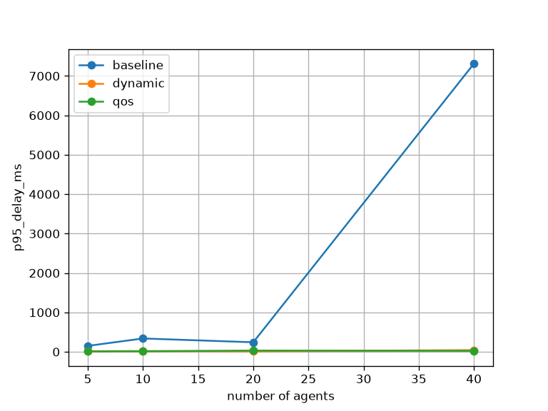
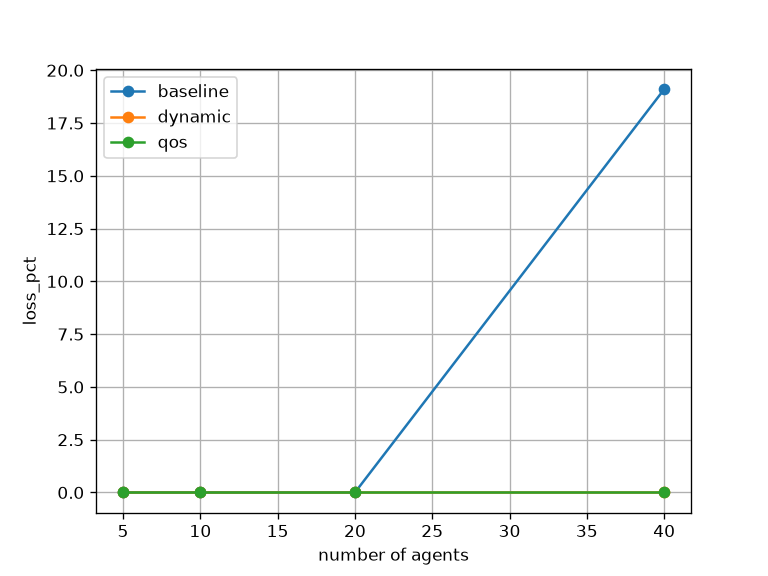

# Remote System Health Monitoring over UDP with SDN Prioritisation

**Course project: SDN + Socket Programming (Mininet + Ryu + UDP)**

## 1. Problem and objectives

A set of simulated servers periodically report CPU, memory, process count and network rate to a central monitoring server over UDP. The goal is to show that an SDN controller can keep this monitoring traffic timely when the network is congested.

Objectives:
- UDP health-reporting agents and a centralised monitoring server
- Alert thresholds and node-failure detection
- Prioritise critical monitoring traffic using SDN (OpenFlow queues)
- Simulate node failures, congestion and an unauthorised sender
- Measure alert latency and evaluate scalability against a baseline

## 2. Architecture

```
 h1 h2 ... hN  (agents)        ns (noise source)    rogue
        \ | /                         |                |
         [ s1 ] ===== 10 Mbps bottleneck ===== [ s2 ] -- srv (monitor, 10.0.0.100)
                                                  |  \-- nk (noise sink)
                                                  |
                                         root namespace 10.0.0.254
                                         (Ryu controller, UDP control port 9999)
```

| Component | File | Role |
|---|---|---|
| Agent | `agent.py` | Sends one JSON datagram per second to UDP port 5000. It can simulate a CPU spike |
| Monitor | `server.py` | Receives reports, applies thresholds, detects dead nodes, rogue senders and congestion, logs to CSV |
| Controller | `controller.py` | Ryu OpenFlow 1.3 learning switch with priority queueing, plus a UDP control channel |
| Topology | `topo.py` | Mininet topology, 10 Mbps bottleneck and OVS HTB queues |
| Experiments | `experiment.py`, `analyze.py` | Automated runs and result analysis |

### Message format (agent to monitor)
```json
{"id": "h1", "seq": 12, "ts": 1794306564.8, "cpu": 93.6, "mem": 41.2,
 "procs": 97, "net_mbps": 23.4, "event_ts": 1794306564.8}
```
`ts` is the send time. It is used for one-way delay (all hosts share one clock in Mininet). `event_ts` is only set during a simulated spike and gives the alert-latency reference point.

### Thresholds
CPU > 90 %, memory > 90 %, processes > 400, network > 80 Mbps. A node is declared DOWN after 3 missed intervals (3 s).

### Socket to SDN integration
The monitor sends UDP control messages to the controller (10.0.0.254:9999):
- `{"cmd":"congestion"}` is sent when average report delay exceeds 50 ms. In `dynamic` mode the controller then turns on priority queueing and flushes flows.
- `{"cmd":"block","ip":...}` is sent when an unauthorised sender is seen. The controller installs a priority-100 drop rule on all switches.
- `{"cmd":"unblock","ip":...}` removes the block.

### SDN behaviour
UDP port 5000 traffic gets the rule `priority=10, udp, tp_dst=5000 -> set_queue:1, output`. Queue 1 has higher HTB priority than queue 0 on every switch port, so health reports overtake the bulk traffic.

## 3. Modes compared

| Mode | Controller behaviour |
|---|---|
| `baseline` | Plain learning switch, no prioritisation (static baseline) |
| `qos` | Priority queue for health traffic always on |
| `dynamic` | Starts as baseline. Priority turns on after the monitor reports congestion |

## 4. Reproducing the results

Tested on Ubuntu with Mininet 2.3.0, Open vSwitch 3.7.1, Ryu 4.34 (Python 3.9 venv; the system Python is too new for Ryu).

### Install
```bash
sudo apt install -y mininet openvswitch-switch iperf python3-matplotlib git
~/.local/bin/uv venv --python 3.9 ~/ryu-venv39
source ~/ryu-venv39/bin/activate
~/.local/bin/uv pip install "setuptools<58" "eventlet==0.30.2" ryu
```

### Socket-only test (no Mininet)
```bash
python3 server.py --port 5555 --outdir /tmp/t          # terminal 1
python3 agent.py --id h1 --server 127.0.0.1 --port 5555 --spike-after 3 --duration 10   # terminal 2
```

### Manual demo
```bash
source ~/ryu-venv39/bin/activate
MODE=qos ryu-manager controller.py                      # terminal A (leave running)
sudo mn -c ; sudo python3 topo.py                       # terminal B (run mn -c BEFORE starting Ryu)
mininet> h1 ping -c 3 srv
mininet> srv python3 server.py --controller 10.0.0.254 --outdir /tmp/m > /tmp/srv.log 2>&1 &
mininet> h1 python3 agent.py --id=h1 --server 10.0.0.100 --spike-after 5 --duration 15 &
mininet> sh ovs-ofctl -O OpenFlow13 dump-flows s1       # shows set_queue:1 on udp_dst=5000
```
Notes: use `--id=h1` (with `=`) in the Mininet CLI, because the CLI replaces a bare `h1` with its IP address. Do not run `sudo mn -c` while Ryu is running, because it kills Ryu.

### Full experiment
```bash
sudo mn -c
sudo env RYU_MANAGER=$HOME/ryu-venv39/bin/ryu-manager python3 experiment.py \
     --modes baseline,qos,dynamic --sizes 5,10,20,40 --duration 50 --noise on
sudo chown -R $USER:$USER results
python3 analyze.py        # writes results/summary.csv and the PNG graphs
```

### Timeline of each run (50 s)
| Time | Event |
|---|---|
| 0 s | All agents start |
| 5 s | 12 Mbps UDP flood across the 10 Mbps bottleneck |
| 15 s | `h1` simulates a CPU spike (alert-latency measurement) |
| 30 s | `h2` is killed (failure-detection measurement) |
| 37 s | A rogue host sends reports (unauthorised-access scenario) |

## 5. Results

Congestion present (12 Mbps flood on a 10 Mbps link); one run per configuration.

| Agents | Mode | p95 delay (ms) | Alert latency (ms) | Loss (%) |
|---|---|---|---|---|
| 5 | baseline | 150.2 | 91.9 | 0 |
| 5 | qos | 9.9 | 0.62 | 0 |
| 5 | dynamic | 15.2 | 2.46 | 0 |
| 10 | baseline | 338.2 | 87.4 | 0 |
| 10 | qos | 14.7 | 2.4 | 0 |
| 10 | dynamic | 17.9 | 1.11 | 0 |
| 20 | baseline | 241.8 | 439.3 | 0 |
| 20 | qos | 31.1 | 0.93 | 0 |
| 20 | dynamic | 12.1 | 1.98 | 0 |
| 40 | baseline | 7310.6 | 5371.3 | 19.1 |
| 40 | qos | 24.1 | 1.49 | 0 |
| 40 | dynamic | 43.3 | 1.62 | 0 |

Full data: `results/summary.csv`. Graphs: `results/p95_delay_ms.png`, `results/loss_pct.png`.




### Observations
- Under congestion, baseline delay and loss grow with the number of agents. At 40 agents, alert latency is about 5.4 s and 19 % of reports are lost.
- With priority queueing (`qos`, `dynamic`), alert latency stays around 1 to 2.5 ms and no reports are lost, even at 40 agents.
- `dynamic` performs close to `qos`, with a small penalty during the interval before congestion is detected.
- Node-down detection takes about 2 to 3 s in every mode. It is set by the 3 s heartbeat timeout, so it does not depend on the SDN.
- The rogue sender was detected and blocked by the controller in every run.

### Challenging scenarios demonstrated
1. **Congestion:** flood across the bottleneck (baseline degrades, QoS holds).
2. **Node failure:** agent killed, detected by heartbeat timeout.
3. **Unauthorised access:** unknown sender is flagged by the monitor and blocked by the controller.

## 6. Limitations
- Each configuration was run once, so single values (for example the 10-agent baseline) are noisy. Trends matter more than individual numbers.
- Alert latency is one sample per run (one spike).
- Everything runs on one VM, so at 40 agents some delay may come from CPU load.
- One-way delay relies on the shared clock inside Mininet.
- Congestion appears as delay, not loss, until the queue overflows, because the switch queues are deep.

## 7. Repository layout
```
agent.py  server.py  controller.py  topo.py  experiment.py  analyze.py  README.md
results/   per-run CSV logs, summary.csv, graphs
```
